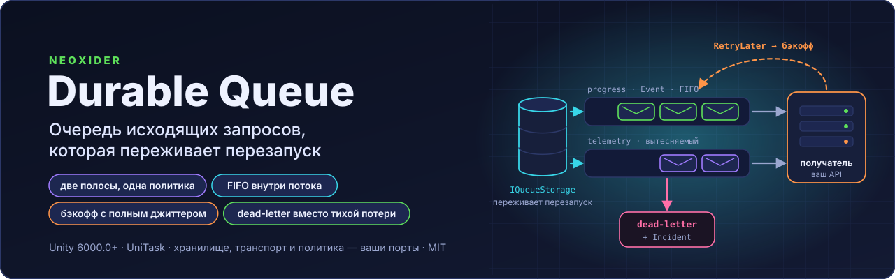
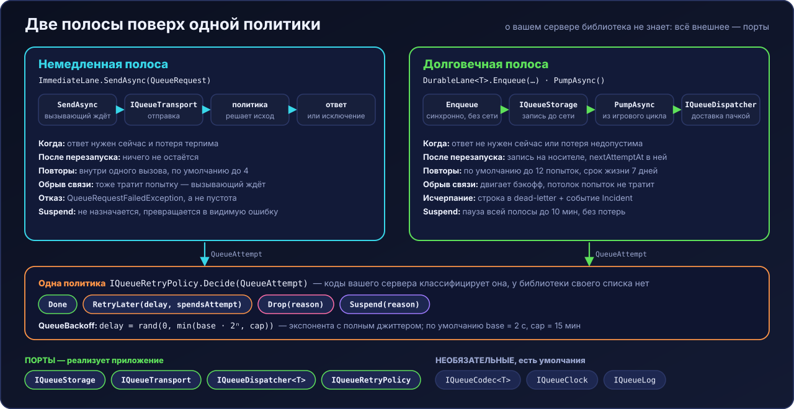

<p align="center">
  
</p>

#  Neoxider Durable Queue

**Очередь исходящих запросов, которая переживает перезапуск.** Отправить на сервер, пережить закрытие
приложения, повторить с бэкоффом, не применить дважды и не потерять молча — работа любого клиента с
ненадёжной сетью, вынесенная в отдельную библиотеку.

[](https://unity.com/releases/editor)
[](LICENSE.md)
[](CHANGELOG.md)

<sub>
<a href="#зачем">Зачем</a>&nbsp;&nbsp;•&nbsp;
<a href="#возможности">Возможности</a>&nbsp;&nbsp;•&nbsp;
<a href="#две-полосы-поверх-одной-политики">Две полосы</a>&nbsp;&nbsp;•&nbsp;
<a href="#установка">Установка</a>&nbsp;&nbsp;•&nbsp;
<a href="#быстрый-старт">Быстрый старт</a>&nbsp;&nbsp;•&nbsp;
<a href="#два-класса-записей">Классы записей</a>&nbsp;&nbsp;•&nbsp;
<a href="#что-стоит-знать-до-первого-использования">Что знать</a>&nbsp;&nbsp;•&nbsp;
<a href="#чего-библиотека-не-делает">Чего не делает</a>&nbsp;&nbsp;•&nbsp;
<a href="#лицензия">Лицензия</a>
</sub>

---

## Зачем

Задача у очереди одна и не про конкретный проект: **отправить на сервер, пережить закрытие приложения,
повторить с бэкоффом, не применить дважды и не потерять молча**. Это работа любого клиента с
ненадёжной сетью.

Библиотека **не знает ничего** о вашем сервере: ни адресов, ни кодов ошибок, ни схемы авторизации, ни
понятий вашей предметной области. Хранилище, транспорт, политика повторов, формат, журнал и часы —
порты. Внутрь приходит просто строковый ключ и просто полезная нагрузка.

---

## Возможности

- **Две полосы поверх одной политики** — `ImmediateLane` (ответ или видимая ошибка в пределах вызова) и
  `DurableLane<T>` (запись на носителе, доставка позже, переживает перезапуск).
- **Потоки** — строгий FIFO внутри потока, независимость между потоками; `independentTargets` переносит
  FIFO на уровень адреса.
- **Два класса записей** — `Event` (факт, не схлопывается) и `State` (снимок, глубина потока 1).
- **Повторы** — экспоненциальный бэкофф с полным джиттером (`QueueBackoff`), срок следующей попытки
  лежит в самой записи; ответы сервера и обрывы связи считаются отдельно.
- **Лимиты** (`QueueLimits`, значения по умолчанию) — мягкий бюджет очереди 256 КБ сериализованного вида,
  запись до 32 КБ, срок жизни 7 дней, до 12 попыток (считаются только ответы сервера), приостановка
  снимается сама через 10 минут, dead-letter помнит 20 последних неудач.
- **Наблюдаемые потери** — вытеснение, превышение бюджета, постоянный отказ, исчерпание попыток и истечение
  срока дают событие `Incident` и строку в dead-letter (метаданные, без нагрузки).
- **Пачки** — `maxBatchSize` потока, частичный отказ `QueueBatch.Reject(...)` и частичное подтверждение
  `QueueBatch.Confirm(...)`.
- **Идемпотентность** — `idempotencyKey` при постановке; правило вывода ключа остаётся за вызывающим.

---

## Две полосы поверх одной политики

<p align="center"></p>

| | Немедленная | Долговечная |
|---|---|---|
| Когда | ответ нужен сейчас **и** потеря терпима | ответ не нужен сейчас **или** потеря недопустима |
| Переживает перезапуск | нет | да |
| При исчерпании | **исключение вызывающему** | dead-letter + происшествие |

Условия долговечной полосы соединены «или», и второе сильнее первого: **запись, которую нельзя
потерять, идёт в очередь даже тогда, когда ответ хотелось бы получить сразу.** Обратное рассуждение
— «мы же ждём ответ, значит немедленная полоса» — и есть типичная причина потери данных: вызов
возвращает результат, результат никто не читает, а факт до сервера не доехал.

Цену за это платит **вызывающий**: он обязан уметь продолжить без ответа сервера. Результат
применяется локально сразу, доставку гарантирует очередь, подтверждение приходит позже и меняет
отображение, а не ход работы.

---

## Установка

Unity **6000.0+**. Зависимости объявлены в `package.json` явно: `com.cysharp.unitask` 2.5.0 и
`com.unity.nuget.newtonsoft-json` 3.2.1. Newtonsoft приезжает из реестра Unity сам, а **UniTask в реестре
Unity нет** — без него пакет не разрешится. Подключите UniTask одним из двух способов.

**Вариант 1 — scoped registry OpenUPM** в `Packages/manifest.json`:

```json
{
  "scopedRegistries": [
    {
      "name": "package.openupm.com",
      "url": "https://package.openupm.com",
      "scopes": ["com.cysharp"]
    }
  ],
  "dependencies": {
    "com.cysharp.unitask": "2.5.0",
    "com.neoxider.durablequeue": "https://github.com/NeoXider/DurableQueue.git#v0.3.0"
  }
}
```

**Вариант 2 — UniTask из git**, затем сам пакет. Package Manager → *Add package from git URL*, по очереди:

```text
https://github.com/Cysharp/UniTask.git?path=src/UniTask/Assets/Plugins/UniTask#2.5.0
https://github.com/NeoXider/DurableQueue.git#v0.3.0
```

или в `Packages/manifest.json`:

```json
"com.cysharp.unitask": "https://github.com/Cysharp/UniTask.git?path=src/UniTask/Assets/Plugins/UniTask#2.5.0",
"com.neoxider.durablequeue": "https://github.com/NeoXider/DurableQueue.git#v0.3.0"
```

---

## Быстрый старт

```csharp
using Neoxider.DurableQueue;
using Neoxider.DurableQueue.Lanes;
using Neoxider.DurableQueue.Ports;

DurableLane<LevelResult> queue = new(
    storage,                       // ваш IQueueStorage: префы, файл, база браузера
    dispatcher,                    // ваш IQueueDispatcher: типизированный клиент или транспорт
    policy,                        // ваш IQueueRetryPolicy: коды вашего сервера
    new DurableLaneOptions(
        recordsKey: "outbox",
        streams: new[]
        {
            new QueueStreamOptions("telemetry", evictable: true, evictionPriority: 1),
            new QueueStreamOptions("progress", flushOnWrite: true) // не вытесняется никогда
        }));

// Постановка синхронна и сети не касается: вызов заканчивается тем, что факт записан локально.
queue.Enqueue("level_complete", stream: "progress", payload: result, idempotencyKey: operationId);

// Насос зовётся из игрового цикла; он сам решает, чему пора ехать, а чему ещё рано.
await queue.PumpAsync(cancellationToken);
```

Чтение — другая полоса, и отказ там **виден**:

```csharp
QueueResponse answer = await immediate.SendAsync(new QueueRequest("GET", url));
// исчерпание повторов и постоянный отказ прилетают QueueRequestFailedException, а не пустотой
```

Политика — единственное место, где живут коды вашего сервера. Набросок (коды условные):

```csharp
sealed class MyServerPolicy : IQueueRetryPolicy
{
    public QueueRetryDecision Decide(QueueAttempt attempt)
    {
        QueueResponse response = attempt.Response;
        if (response.TransportFailure) return QueueRetryDecision.RetryLater(reason: "offline");
        if (response.StatusCode is >= 200 and < 300) return QueueRetryDecision.Done();
        if (response.StatusCode == 401) return QueueRetryDecision.Suspend("auth");
        if (response.StatusCode == 429 || response.StatusCode >= 500)
            return QueueRetryDecision.RetryLater(reason: "server busy");
        return QueueRetryDecision.Drop($"rejected with {response.StatusCode}");
    }
}
```

---

## Два класса записей

- **`Event`** — факт, который случился один раз: строгий FIFO внутри потока, снимается только по
  подтверждению, не схлопывается никогда.
- **`State`** — снимок, у которого важно только последнее значение: новая запись вытесняет старую,
  глубина потока всегда 1.

Без этого различия очередь либо раздувается (каждое промежуточное значение — отдельная запись), либо
теряет факты (схлопывание там, где схлопывать нельзя).

---

## Что стоит знать до первого использования

- **Потоки независимы, глобального порядка нет.** Внутри потока — строгий FIFO с head-of-line
  blocking, между потоками — независимость: застрявшая запись держит свой поток и только его.
- **Адрес доставки фиксируется при ПОСТАНОВКЕ** (`target` в конверте). Пустой адрес — законное
  состояние: такие записи не отправляются и попыткой это не считается, а адрес им ставит
  `AssignTargetToUnaddressed`, сохраняя его на носитель **до** сетевого вызова. Бросить адрес
  позволено только по доказательству от сервера — для этого есть `Readdress`.
- **Счётчиков неудач два.** Ответы сервера расходуют потолок попыток; отсутствие сети двигает
  бэкофф, но потолка не касается — иначе час без связи сам стал бы механизмом потери данных.
- **Потоки фактов, которые нельзя терять никогда**, настраиваются опциями потока:
  `neverExpires` (срок жизни не применяется), `retainWhenStorageRefuses` (отказ носителя не снимает
  запись — она доставляется из памяти), а политика может вернуть `RetryLater(spendsAttempt: false)`,
  чтобы временный отказ идемпотентного получателя не расходовал потолок попыток.
- **Пачка ограничивается и отказывается частично.** `maxBatchSize` потока держит пачку в пределах
  одного запроса получателя, а `QueueBatch.Reject(record, ...)` снимает из пачки одну ядовитую запись
  (строка в dead-letter), не утягивая за собой соседей; `QueueBatch.Confirm(record)` снимает уже
  принятую часть сразу.
- **Независимые адреса и незнакомые виды.** `independentTargets` держит FIFO внутри адреса, а не
  потока; `knownKinds` полосы пропускает записи, которые эта версия приложения доставить не умеет, —
  они хранятся для версии, которая умеет.
- **`nextAttemptAt` лежит в записи**, а не в таймере: иначе перезапуск сбрасывает бэкофф в ноль и
  очередь уходит на сервер штормом ровно в момент старта.
- **Пока `IQueueStorage.IsAddressable` отвечает `false`, очередь ничего не считает прочитанным** и
  не отправляет: ключ бывает «ещё не готов», и прочитать в этот момент — значит получить честное
  «данных нет» и первой же записью затереть сохранённое.
- **Потери наблюдаемы.** Вытеснение, превышение бюджета, постоянный отказ, исчерпание попыток и
  истечение срока — событие `Incident` и строка в dead-letter (метаданные, без нагрузки).

---

## Чего библиотека НЕ делает

Граница ответственности честнее списка возможностей.

- **Не знает семантики вашего HTTP-API.** Коды ответов классифицирует подключаемая политика; своего
  списка кодов у библиотеки нет и не будет.
- **Не собирает запросы.** Адреса, заголовки и тела строит ваш транспорт или диспетчер.
- **Не шифрует и не сжимает.** Что положили, то и лежит.
- **Не хранит учётные данные.** Заголовки авторизации берутся в момент отправки и в очередь не
  попадают никогда.
- **Не синхронизируется между вкладками и не берёт блокировок.** Два экземпляра приложения над одним
  хранилищем — не поддерживаемый сценарий.
- **Не гарантирует доставку при закрытии вкладки.** Она превращает «потеряно навсегда» в «доедет при
  следующем запуске», но не в «доедет сейчас».
- **Не разрешает конфликты состояний.** Optimistic concurrency — забота вызывающего.
- **Не потокобезопасна.** Рассчитана на однопоточный игровой цикл.
- **Не считает идентификаторы идемпотентности.** Правило их вывода предметное: у факта одно, у
  снимка другое, и внутрь библиотеки оно не попадает.

---

## Документация

| Что | Где |
|---|---|
| История версий | [CHANGELOG.md](CHANGELOG.md) |
| Порты: хранилище, транспорт, диспетчер, политика, формат, часы, журнал | [`Runtime/Ports`](Runtime/Ports) |
| Полосы и их опции | [`Runtime/Lanes`](Runtime/Lanes) |
| Поведение, закреплённое тестами | [`Tests`](Tests) |

---

## Лицензия

[MIT](LICENSE.md), © 2026 Neoxider.

**Автор:** [Neoxider](https://github.com/NeoXider) · **Вопросы и ошибки:**
[GitHub Issues](https://github.com/NeoXider/DurableQueue/issues)
